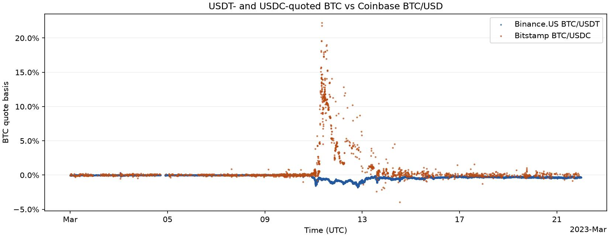

# Bitcoin pricing during the March 2023 USDC depeg

This IAQF Student Competition research project asks how much the price of one bitcoin differed depending on whether it was quoted in USD, USDC or USDT. It compares six one-minute market series from Binance.US, Bitstamp and Coinbase over March 1–21, 2023, including the weekend of Silicon Valley Bank’s failure.

**The largest differences were in USDC-quoted prices.** During March 10–12 there were 499 minutes with positive volume in all six series. In those same minutes, the median price difference was +1.66% for BTC/USDC relative to BTC/USD on Bitstamp and −3.15% for BTC/USDT relative to BTC/USDC on Binance.US. The cross-venue BTC/USDT basis against Coinbase dollars was −0.57%. Holding the venue fixed in the first two comparisons helps identify which quote currency weakened.



Circle disclosed that $3.3 billion of USDC reserves were held at Silicon Valley Bank, about 8% of the total. This provides an explanation for the USDC discount. The BTC candles measure relative prices and cannot by themselves identify a bank deposit or attribute a BTC price move to the bank failure. [Circle disclosure](https://www.circle.com/pressroom/3-3-billion-of-usdc-reserve-risk-removed-dollar-de-peg-closes) · [Federal Reserve event study](https://www.federalreserve.gov/econres/notes/feds-notes/in-the-shadow-of-bank-run-lessons-from-the-silicon-valley-bank-failure-and-its-impact-on-stablecoins-20251217.html)

[Research paper (PDF)](reports/stablecoin_research_report.pdf) · [Period summaries (CSV)](results/tables/q1_summary.csv) · [繁體中文執行指南](docs/guide.zh-Hant.md)

## Reproduce the study

Use Python 3.12 in a virtual environment. Run these commands from the repository root in Windows PowerShell.

```powershell
py -3.12 -m venv .venv
.\.venv\Scripts\python -m pip install -e .
.\.venv\Scripts\python -m iaqf --offline
.\.venv\Scripts\python -m unittest discover -s tests -v
```

For macOS or Linux, use the following commands.

```sh
python3.12 -m venv .venv
.venv/bin/python -m pip install -e .
.venv/bin/python -m iaqf --offline
.venv/bin/python -m unittest discover -s tests -v
```

Installation requires access to the Python dependencies. After installation, the study and tests run offline. The command rebuilds five CSVs under `results/tables/` and eight JPEGs under `results/figures/`. The repository tracks the summary, quality audit and figures. The three larger minute-level tables are generated locally and ignored by Git. Use `--output-dir PATH` to write a separate run.

## Data and interpretation

The six OHLCV snapshots supplied with the study each cover 30,240 UTC minutes. The original files include filled minutes and have no observation flag. On Bitstamp, BTC/USDC had zero volume in 28,072 minutes. Each comparison therefore requires positive volume and valid closing prices on both legs in the same minute. Different pairs can have different sample sizes. The 499-minute figures above use the intersection of all six markets. The downloadable period summary uses each pair’s own eligible minutes. [Snapshot directory](data/raw/) · [Data quality audit](results/tables/missing_report.csv)

The signed basis is `(left BTC price − right BTC price) / right BTC price`. A positive Bitstamp BTC/USDC basis means that one BTC cost more units of USDC than USD. Individual fills within a minute can occur at different times. Fee bands sum two assumed taker fees and exclude bid–ask spreads, slippage and funding costs.

## Project guide

| Location | Contents |
| --- | --- |
| [src/iaqf/workflow/](src/iaqf/workflow/) | Five stages covering market inputs, validation, alignment, analysis and report outputs |
| [src/iaqf/analysis/](src/iaqf/analysis/) | BTC quote comparisons, event windows and summary statistics |
| [src/iaqf/reporting/](src/iaqf/reporting/) | The eight figures used in the paper |
| [tests/](tests/) | Offline unit and integration tests, including partial downloads and failed output publication |
| [reports/](reports/) | Main paper in PDF and editable Word format, with the original strategy note in a separate supplement |

The reproducible workflow covers the March 2023 event study. The separate strategy note describes its own longer-period analysis. The [Chinese guide](docs/guide.zh-Hant.md) includes a short calculation for checking the three matched-minute medians directly from the regenerated detail CSV.
